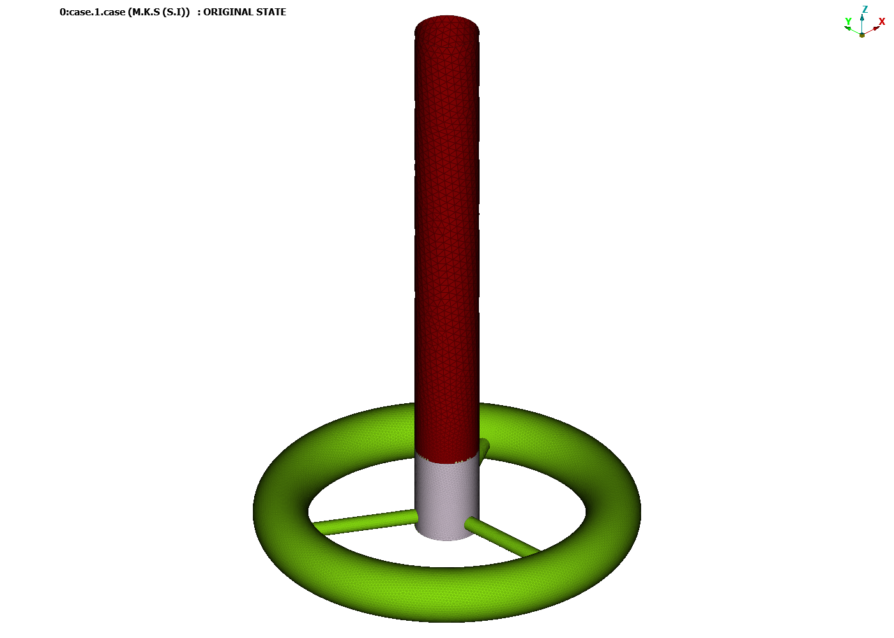
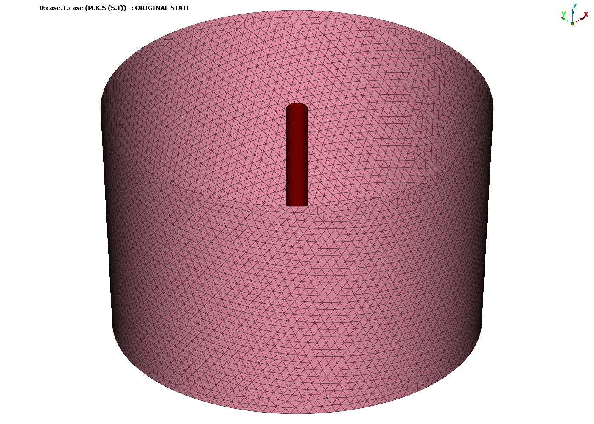
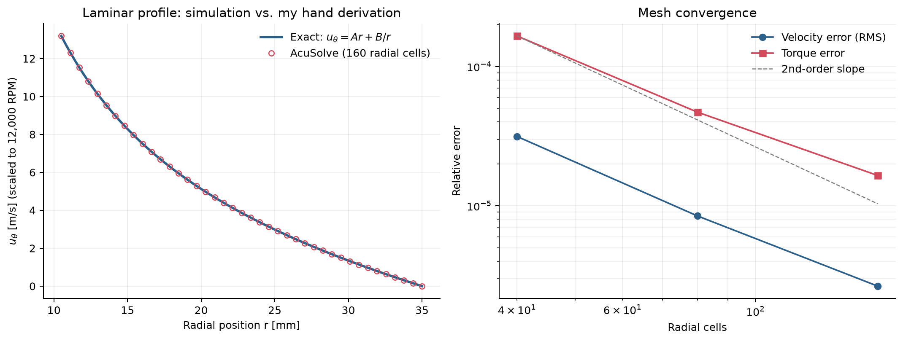
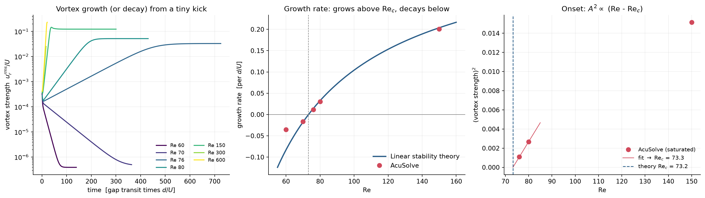
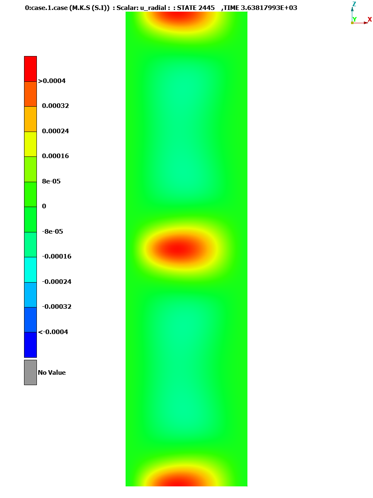
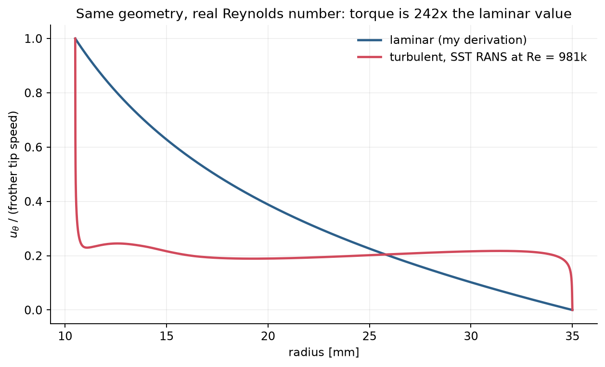
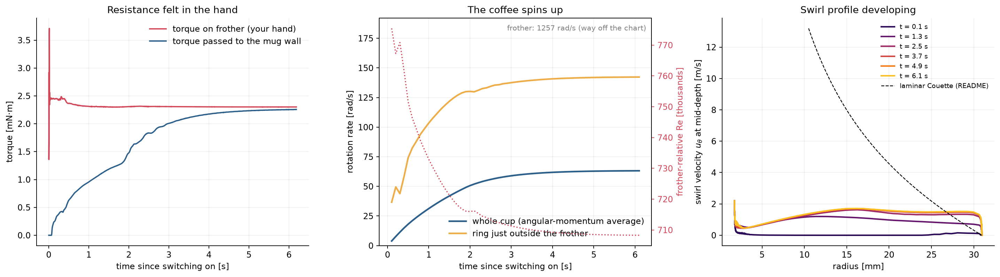
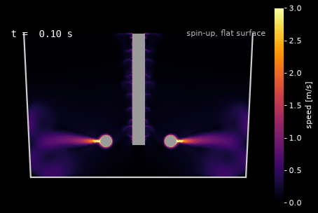
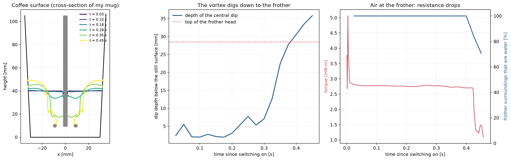

# Coffee Dynamics

Every single morning without fail, I drink a cup of coffee. Not anything fancy. Just [Nescafe](https://www.nescafe.com/us/products/dark-roast-instant-coffee-7-oz-jar/) instant coffee, dry whole milk, and hot water. Very chill. I've made this exact cup probably a couple thousand times by now, so I know every single step of it by feel. It's all very intuitve to me. I know the ratio of powder to water, I know when to stop frothing, I know exactly what it's supposed to look like when it's done. 

But something happens during the frothing step that I've never really stopped to think about until recently. When I first put the frother in and turn it on, the flow is very rough and turbulent, it's chaotic. You can literally feel the resistance in your hand. But after a few seconds, something changes and shifts. The mixture smoothens out. The resistance changes and it goes from feeling very violent to feeling almost organized. As if this was all by design. 

This is my attempt to answer that question properly. Not just qualitatively, but mechanistically. The geometry here will be my actual mug. The goal is to model the transition from turbulent to laminar flow in a cup of cofee, and to understand every step of that model. 

> [!NOTE]
> The hand derivation below is the start. The CFD sections after it are the part I actually ran, on this machine, with AcuSolve. The whisk geometry is still an estimate, foam is not in the model, and I have not filmed the real cup yet. So, pls excuse any spelling, grammar, or formatting mistakes (there are a ton).
>
> I got into this kind of problem through undergrad research with the [Park Research Group](https://mmfd.unl.edu/). That is where I learned to take a flow apart instead of just watching it. The runs on this page are mine. 


<br> 

### My Mug
| Parameter |Symbol | Value |
| -------- | -------- | -------- |
| Inner Radius (at the rim) | R<sub>2</sub> | 0.035 m |
| Inner Radius (at the bottom, estimated) | -- | 0.030 m |
| Outer Radius | -- | 0.0425 m |
| Total height | -- | 0.105 m |
| Liquid depth during frothing | H | 0.04 m |

The inside of the mug tapers: it widens smoothly from the bottom to the rim. The hand derivation below uses the rim radius as if the walls were straight; the CFD sections later use the real taper.


<br>

### My Frother
##### https://www.amazon.com/CIRCLE-JOY-Rechargeable-Cappuccino-Chocolate/dp/B0FT3VTD72?th=1
| Parameter |Symbol | Value |
| -------- | -------- | -------- |
| Disc Radius | R<sub>1</sub> | 0.0105 m |
| Speed setting used | -- | Mid (12,000 RPM) |
| Angular velocity | $\Omega$<sub>1</sub> | 1,257 rad/s |

<br>

### Misc. Geometry
| Parameter |Symbol | Value |
| -------- | -------- | -------- |
| Gap width | d = R<sub>2</sub> - R<sub>1</sub> | 0.0245 m |
| Radius ratio | $\eta = \frac{R_1}{R_2}$ | 0.30 |

<br>

### How turbulent is this?
The Reynolds number is the first thing I thought of computing. It is a famous yet relatively simple formula that tells you whether a flow is laminar or turbulent by comparing the inertial forces to the viscous forces. A high Re means inertia dominates (turbulent flow). Low Re means viscosity dominates (laminar flow).

For this particular setup, since our flow is rotational, I used the [Rotational Reynolds Number](https://www.sciencedirect.com/topics/engineering/rotational-reynolds-number) expression defined as:

<div align="center">

$$Re = \frac{\Omega_1 R_1 d}{\nu}$$

</div>

where $\nu$ is the kinematic viscosity of water around 85°C, which is $3.3 \cdot 10^{-7}\ \text{m}^2/\text{s}$. So, plugging everything in:

<div align="center">

$$Re = \frac{1257 \cdot 0.0105 \cdot 0.0245}{3.3 \cdot 10^{-7}} \approx 981,000$$

</div>

Typical pipe flow transistions to turbulence around Re ~ 2,300. This flow is more than 400 times past that. This means that the coffee in my mug every morning is in an extremely violent turbulent state the moment my frother touches it.

### What's actually happening.
Having established that at its worst, my coffee flows with a Reynolds number of nearly a million (981,000), equivalent to the flow an aircraft wing experiences during flight, the question then begs itself. How does this slow down? Where does the smooth, laminar feeling come from, and where does the froth come in?

My first thought was the dissolving of the dry powder into the water. This made the most sense to me intuitively. Undissolved powder particles increase the effective viscosity of the mixture, and as they dissolve the fluid becomes more homogeneous, less resistive. And while this is definitely a factor, it's not the main one. The frother is spinning at 1,257 rad/s. Even a fairly thick, clumpy mixture would be torn to shreds almost instantly at that shear rate. The dissolving happens in the first half second. The smooth feeling comes around 10 seconds later. Something else is sustaining the turbulence after the clumps are gone.

It's explained by two things happening simultaneously. 

First, the bulk fluid spins up. At t=0 the fluid is basically stationary and the frother disc is screaming at 1,257 rad/s. That enormous velocity difference is what drives the turbulence. As you froth, momentum transfers from the disc to the fluid. The whole liquid mass begins to rotate with the frother. The relative velocity between disc and fluid drops, and Re drops with it, because Re depends on that relative velocity.

This part is fairly intuitive. But it still doesn't explain the froth.

The froth doesn't come after laminarization. It comes alongside it, and it actually helps cause it. As air gets entrained into the liquid during frothing, foam forms at the surface. Foam is not a normal fluid. It behaves somewhere between a liquid and a soft solid, and its effective viscosity is orders of magnitude higher than water. Higher viscosity means lower Re. The foam layer actively suppresses turbulent fluctuations from the top down, while spin-up suppresses them from the bottom up. They meet in the middle. The smooth feeling and the froth appearing are not sequential. They are coupled. The froth is part of what's killing the turbulence, not a consequence of it.

To put it simply: in the early violent turbulent phase, air bubbles are being entrained and immediately destroyed by turbulent eddies. The flow is too chaotic to let stable foam structure form. It's only as turbulence weakens that bubbles survive long enough to organize into foam. And there's the feedback loop, weakening turbulence allows foam to form, and forming foam further weakens turbulence.


<p align="center">
  
</p>

### Simplifying Navier-Stokes

The Navier-Stokes equations govern this entire problem. They are a set of equations that describe the motion of viscous fluids. A suite of partial differential equations that mathematically balance acceleration against pressure gradients, viscous forces, and body forces. In their Cartesian form, they are expressed as:

$$\rho\left[\frac{\partial u}{\partial t} + u\frac{\partial u}{\partial x} + v\frac{\partial u}{\partial y} + w\frac{\partial u}{\partial z}\right] = -\frac{\partial p}{\partial x} + \mu\left(\frac{\partial^2 u}{\partial x^2} + \frac{\partial^2 u}{\partial y^2} + \frac{\partial^2 u}{\partial z^2}\right) + \rho g_x$$

$$\rho\left[\frac{\partial v}{\partial t} + u\frac{\partial v}{\partial x} + v\frac{\partial v}{\partial y} + w\frac{\partial v}{\partial z}\right] = -\frac{\partial p}{\partial y} + \mu\left(\frac{\partial^2 v}{\partial x^2} + \frac{\partial^2 v}{\partial y^2} + \frac{\partial^2 v}{\partial z^2}\right) + \rho g_y$$

$$\rho\left[\frac{\partial w}{\partial t} + u\frac{\partial w}{\partial x} + v\frac{\partial w}{\partial y} + w\frac{\partial w}{\partial z}\right] = -\frac{\partial p}{\partial z} + \mu\left(\frac{\partial^2 w}{\partial x^2} + \frac{\partial^2 w}{\partial y^2} + \frac{\partial^2 w}{\partial z^2}\right) + \rho g_z$$

But for this problem our flow is rotational, so we use the cylindrical form of Navier-Stokes, where the dominant motion is azimuthal. The azimuthal component is expressed as:

$$\rho\left(\frac{\partial u_\theta}{\partial t} + u_r\frac{\partial u_\theta}{\partial r} + \frac{u_\theta}{r}\frac{\partial u_\theta}{\partial \theta} + \frac{u_r u_\theta}{r} + u_z\frac{\partial u_\theta}{\partial z}\right) = -\frac{1}{r}\frac{\partial p}{\partial \theta} + \mu\left(\frac{\partial^2 u_\theta}{\partial r^2} + \frac{1}{r}\frac{\partial u_\theta}{\partial r} - \frac{u_\theta}{r^2} + \frac{1}{r^2}\frac{\partial^2 u_\theta}{\partial \theta^2} + \frac{\partial^2 u_\theta}{\partial z^2}\right) + \rho g_\theta$$

This is a nastier form of NS, but one that can be simplified considerably. Thinking of NS as a form of Newton's Second Law (F = ma) makes this process cleaner. The left side contains the inertial forces, the acceleration of the fluid. The right side contains the forces that drive the flow, the pressure gradient, viscous forces, and gravity.

Before simplifying, some assumptions must be made. I plan to work two cases, one where the flow is steady, and one where it is not. Now obviously the whole point of this project is that the flow transitions from turbulent to laminar over about 10 seconds. If we assume steady state, then by definition the flow is already done transitioning. But to solve this differntial equation by hand, the time term has to go. Before the assumptions, a shoutout to the professor who taught me fluid mechanics, [Dr. Nitesh Nama](https://niteshnama.weebly.com/), a brilliant man.

#### Assumptions

| # | Assumption | Consequence |
|---|---|---|
| 1 | Newtonian fluid | $\mu$ = constant |
| 2 | Incompressible | $\rho$ = constant |
| 3 | Neglect gravity | $g$ = 0 |
| 4 | Axisymmetric | $\partial/\partial\theta$ = 0 |
| 5 | 1D flow | $u_z = u_r = 0$, $\partial/\partial z$ = 0 |
| 6 | No azimuthal pressure gradient | $\partial p/\partial\theta$ = 0 |
| 7 | Steady flow *(Case 1 only)* | $\partial/\partial t$ = 0 |

### Simplifying the Azimuthal Equation

Now that the assumptions are defined, it's time to kill off terms.

As I've stated previously, the dominant motion in this problem is azimuthal, so we start by eliminating anything 
unrelated to that. Gravity acts vertically in the z direction, so by geometry, the 
gravitational body force in the $\theta$ direction is zero. We are looking at a spinning 
flow, not a sinking or rising one. This kills $\rho g_\theta$.

The mug is a cylinder and the frother spins at its center. The flow looks identical no 
matter which radial slice you look at, this is the axisymmetric assumption. Nothing 
varies as you rotate around the axis, so any derivative with respect to $\theta$ is zero. 
This kills three more terms.

The fluid isn't moving radially or vertically on average. The dominant motion is purely 
rotational, and the velocity profile looks the same at every height within the coffee. So 
the radial and vertical velocities are zero, and all z derivatives are zero. This is the 
1D assumption, and it kills the most terms.

What we are left with is:

$$\rho \frac{\partial u_\theta}{\partial t} = \mu\left(\frac{\partial^2 u_\theta}{\partial r^2} + \frac{1}{r}\frac{\partial u_\theta}{\partial r} - \frac{u_\theta}{r^2}\right)$$

This is the governing equation for the fluid in the mug. Left side is inertia, the 
fluid accelerating in the $\theta$ direction over time. Right side is viscosity, the 
only thing driving that acceleration is the diffusion of momentum radially across the gap.

For Case 1, we apply the steady flow assumption. Nothing is changing in time, so 
$\partial/\partial t = 0$. The left side dies, the partial differential equation becomes an ordinary differential equation:

$$\frac{\partial^2 u_\theta}{\partial r^2} + \frac{1}{r}\frac{\partial u_\theta}{\partial r} - \frac{u_\theta}{r^2} = 0$$

This is the equation that I can actually solve by hand. Its solution is the laminar velocity profile 
the flow settles into after the transition, the analytical ground truth that the 
simulation has to match!

### Solving for the Laminar Velocity Profile

The simplified ODE for Case 1 is:

$$\frac{d^2 u_\theta}{dr^2} + \frac{1}{r}\frac{d u_\theta}{dr} - \frac{u_\theta}{r^2} = 0$$

This is an [Cauchy-Euler](https://en.wikipedia.org/wiki/Cauchy%E2%80%93Euler_equation) equation. You assume a solution of the form $u_\theta = r^m$ and substitute in:

$$\frac{du_\theta}{dr} = mr^{m-1}, \qquad \frac{d^2u_\theta}{dr^2} = m(m-1)r^{m-2}$$

Substituting:

$$m(m-1)r^{m-2} + \frac{1}{r}mr^{m-1} - \frac{r^m}{r^2} = 0$$

$$m(m-1)r^{m-2} + mr^{m-2} - r^{m-2} = 0$$

Dividing through by $r^{m-2}$:

$$m(m-1) + m - 1 = 0$$

$$m^2 - 1 = 0$$

$$m = \pm 1$$

Two solutions: $r^{+1}$ and $r^{-1}$. The general solution is a linear combination of both:

$$u_\theta(r) = Ar + \frac{B}{r}$$

#### Boundary Conditions

No-slip at both walls. The fluid at the frother disc moves with the disc, and the fluid 
at the mug wall is stationary:

$$u_\theta(R_1) = \Omega_1 R_1 \qquad \text{(inner wall, frother disc)}$$

$$u_\theta(R_2) = 0 \qquad \text{(outer wall, mug)}$$

Applying the inner boundary condition:

$$AR_1 + \frac{B}{R_1} = \Omega_1 R_1$$

Applying the outer boundary condition:

$$AR_2 + \frac{B}{R_2} = 0$$

Solving this 2x2 system:

$$A = \frac{-\Omega_1 R_1^2}{R_2^2 - R_1^2}, \qquad B = \frac{\Omega_1 R_1^2 R_2^2}{R_2^2 - R_1^2}$$

So the full laminar velocity profile is:

$$\boxed{u_\theta(r) = \frac{\Omega_1 R_1^2}{R_2^2 - R_1^2}\left(\frac{R_2^2}{r} - r\right)}$$

#### Plugging In Real Numbers

Using the measured dimensions of my mug and frother:

$$R_1 = 0.0105 \text{ m}, \quad R_2 = 0.035 \text{ m}, \quad \Omega_1 = 1257 \text{ rad/s}$$

$$A = \frac{-1257 \times (0.0105)^2}{(0.035)^2 - (0.0105)^2} = \frac{-0.1386}{0.001115} = -124.3 \text{ s}^{-1}$$

$$B = \frac{1257 \times (0.0105)^2 \times (0.035)^2}{(0.035)^2 - (0.0105)^2} = \frac{1.698 \times 10^{-4}}{1.115 \times 10^{-3}} = 0.1523 \text{ m}^2\text{/s}$$

The velocity profile across the gap at steady state is therefore:

$$u_\theta(r) = -124.3r + \frac{0.1523}{r}$$

At the frother disc ($r = R_1 = 0.0105$ m):

$$u_\theta(0.0105) = -124.3(0.0105) + \frac{0.1523}{0.0105} = -1.305 + 14.505 = 13.20 \text{ m/s}$$

Which matches $\Omega_1 R_1 = 1257 \times 0.0105 = 13.20$ m/s. Boundary condition satisfied.

At the mug wall ($r = R_2 = 0.035$ m):

$$u_\theta(0.035) = -124.3(0.035) + \frac{0.1523}{0.035} = -4.351 + 4.351 \approx 0 \text{ m/s}$$

Boundary condition satisfied!!!! This is the exact velocity profile the flow settles 
into after the turbulent-to-laminar transition. It is the analytical ground truth 
that the simulation must converge to. Nice :). 

With this analytical solution in mind, plotting it is very straightforward:

```python
R1 = 0.0105       # frother disc radius - m
R2 = 0.035        # mug inner radius - m
Omega1 = 1257     # angular velocity - rad/s

A = (-Omega1 * R1**2) / (R2**2 - R1**2)
B = (Omega1 * R1**2 * R2**2) / (R2**2 - R1**2)

r = np.linspace(R1, R2, 500)
u = A * r + B / r
```

<p align="center">
  
</p>

At $r = R_1 = 10.5$ mm, the fluid moves at 13.2 m/s glued to the frother disc, 
spinning with it. Moving radially outward toward the mug wall, the velocity drops off. 
At $r = R_2 = 35$ mm it hits zero, the fluid at the wall is stationary, stuck to the 
mug. That's no-slip. The curve isn't linear either. That gentle concave decay is the 
signature of cylindrical geometry. In flat plate Cartesian flow it would be a straight 
line. The curvature of the mug is what bends it. Pretty cool when the physics checks out right.

### Visualizing the Transition

The analytical solution gives us $u_\theta(r)$, the azimuthal velocity at every point 
across the gap. So to make this visible, the velocity field is projected onto a top-down 
2D cross section of the mug, colored by speed using a sort of inferno colormap. The frother 
disc sits at the center, and the mug wall is the outer ring.

The spiral structure in the color field rotates at the local angular velocity 
$\omega(r) = u_\theta(r) / r$ at each radial position. Near the frother disc, $\omega$ 
is high and the pattern spins fast. Near the mug wall, $\omega \approx 0$ and it barely 
moves. That differential rotation is exactly what you would see looking straight down 
into a spinning fluid.

At $t = 0$, the fluid is stationary. The frother disc instantly spins up to 
$\Omega_1 R_1 = 13.2$ m/s and momentum begins diffusing outward across the gap. 
The bright ring bleeds outward frame by frame until the gap fills with the smooth 
laminar profile derived earlier.

<p align="center">
  
</p>

The color scale runs from black (zero velocity) through purple, orange, and white 
(13.2 m/s at the disc).

One honest caveat about this animation: to make the momentum spread in a watchable amount of time, `transition_animation.py` uses a viscosity of 0.01 m²/s, about 30,000 times that of real hot water. With the real viscosity, pure viscous diffusion across the gap would take roughly $d^2/\nu \approx 30$ minutes, so the time label is not physical time. The CFD sections below use the real properties.

### Taking it to CFD

The profile above answers a question I had already finished. It assumes the coffee is done changing, the walls are a straight annulus, and there is no air in the mug. None of that is the morning. The morning is a tapered mug, a whisk that is not a disc, and a surface that dips the second I switch the frother on.

So I stopped solving it by hand and ran it. The solver is AcuSolve. The fluid is water at 85°C, the same viscosity as the Reynolds number at the top of this page, not the fake one in the animation. I checked it in layers. First, can it reproduce my math. Then, can it grow the instability that math says should appear. Then the real Reynolds number, in the same simple gap, so I can see how far the hand solution is from the real regime. Then my actual mug. Then the free surface, which is where the air comes in.

The whisk in the model is not the spring on my counter. I never put calipers on the coil, so the head is a solid torus. Ring radius 9 mm, thickness 3 mm, three spokes, a shaft. The head sits 10 mm off the bottom, which is about where I hold it. Every one of those numbers is a guess, written down in `cfd/geometry/params.py`. Close enough to ask the question. Not close enough to claim I simulated that exact whisk.

<p align="center">
  
</p>

That is the head, as the solver sees it. Green is the torus and the spokes. Red is the shaft. The little triangles are the surface mesh. Ignore the banner in the corner. That is just the post-processor announcing itself.

<p align="center">
  
</p>

And that is the coffee, not the ceramic. The mug wall is the outside of the fluid. The shaft sticks up through the middle. The picture is cut open so you can see inside. The real mesh is the whole cup.

A full 3D startup on that mesh was too expensive to be the long run. Half a million cells was already about a minute per time step, which is a day and a half for ten seconds of frothing. The torus is almost the same all the way around, apart from three thin spokes, so the spin-up and the free surface are a 5 degree slice of the tapered mug. The pictures mirror that slice so it reads as a cup. The spokes get their own check later. They do not get to hide.

### Does the solver agree with my math?

Before any of the mug stuff, I had to know the solver could hit the profile I derived. Same annulus, \(R_1 = 10.5\) mm, \(R_2 = 35\) mm, a thin slice with periodic sides, laminar, Re = 50. Three meshes, 40, 80, and 160 cells across the gap.

<p align="center">
  
</p>

Left: the circles are the solver, on the finest mesh. The line is \(u_\theta = Ar + B/r\), the thing I solved by hand. They sit on each other. That is the plot I wanted when I wrote that the simulation has to match.

Right: what happens when the mesh gets finer. Both errors fall, and they fall about as fast as a second-order scheme should. The dashed line is that slope, drawn in so I could not talk myself into a win.

| Radial cells | Velocity error (RMS, relative to the wall speed) | Torque error |
| --- | --- | --- |
| 40 | 3.1e-5 | +0.017% |
| 80 | 8.5e-6 | +0.0047% |
| 160 | 2.7e-6 | +0.0017% |

Cut the spacing in half and the error drops by about four. The fine-grid uncertainty on the torque is 0.0013%. A first try, with only one cell around the slice, plateaued at a 0.05% torque offset, because the walls were flat facets instead of arcs. Eight cells around fixed it. The solver can do the easy problem. Good. The easy problem is not the morning.

### Taylor vortices

The easy problem is also unstable. The laminar profile is only the answer if a small disturbance dies. In this gap, radius ratio 0.30, a stability calculation says that stops being true at Re = 73.2. Above that, the flow wants to stack into doughnut-shaped vortices, Taylor cells, instead of staying a smooth spin.

I checked the stability code on a textbook case first, radius ratio 0.5, where the critical Reynolds number is 68.2. It got 68.2. Then I pointed it at my mug's ratio. Re_c = 73.2, and the cells want to be about 1.95 gaps tall. The domain height is exactly two of those wavelengths, so if the solver is awake it should grow four cells and not three.

Then I kicked the laminar solution with a tiny radial velocity and watched.

<p align="center">
  
</p>

Left: below Re 73 the kick decays into the noise. Above it, it grows and then saturates. The time axis is in gap-transit times, how long it takes the frother speed to cross the gap, so the different cases can sit on one plot.

Middle: the growth rate. The line is the stability calculation. The dots are the solver. They track, including the sign change. A positive growth rate means the kick is amplifying. Negative means viscosity is winning.

Right: the saturated strength, squared, against Re. Near the onset that quantity goes to zero in a straight line. Draw the line back and it crosses zero at Re = 73.3. Theory says 73.2. At Re = 150 the measured growth rate was 0.201 against 0.204 from the linear theory. I am happy with that.

<p align="center">
  
</p>

That strip is the gap, stood on its end. Red is fluid moving outward. Blue is fluid moving inward. Two pairs, stacked, which is what the height was built to hold. The number on the legend is small because the kick is small. The cells are the point, not the color scale. Still not my mug. This is the idealized annulus, at a Reynolds number about ten thousand times too quiet. I needed it anyway. If the solver cannot grow the right instability when I know the answer, I should not trust it when I don't.

### The real Reynolds number

Same annulus. Real viscosity. Re = 981,000. Laminar is no longer the right model, so this run uses a turbulence model, SST k-omega. It does not simulate every eddy. It simulates the average, and lets an extra viscosity stand in for the mixing the eddies would have done. That is a model, not a microscope. It is the right tool for "what does the mean profile look like," and the wrong tool for "show me a single bubble."

<p align="center">
  
</p>

The blue curve is my derivation. The red curve is the turbulent mean, scaled by the frother tip speed so 1.0 is 13.2 m/s. They meet at the two walls, because no-slip does not care what regime you are in, and they do not agree anywhere else. The turbulent profile falls off the frother in a thin layer, sits near a fifth of the tip speed across most of the gap, and drops again at the mug wall. Mid-gap, the hand solution says 0.29 of the tip speed. The turbulent run says 0.19. The shape is the point, not that one number. The derivation is a gentle concave curve. Reality, at this Reynolds number, is a flat core with two boundary layers.

The torque is the rude part. Per unit length, the turbulent torque is 242 times the laminar torque. There is an old fit for this, Wendt in 1933, built for Taylor-Couette torque between about Re 10,000 and 100,000. Push that fit up to 981,000, which it was never meant to do, and the simulation lands about 1.3 times above it. Same neighborhood. Not a proof. Enough to say the solver is not inventing a crazy drag.

So the boxed equation from earlier is the right math for the wrong regime. My coffee never settles onto that blue curve. The animation at the top is a picture of a flow I do not have.

### My actual mug

Then I put the torus, the spokes, and the shaft into the tapered mug and ran the whole thing in 3D. About 1.45 million cells. A steady solver, the kind that assumes the flow is already finished and just iterates toward it.

It stalled. The frother torque settled near 3 mN·m and the mug walls were only taking about 1 mN·m back. In a finished, closed cup those two have to match. What goes in as spin has to come out at the wall, or the coffee is still accelerating. The steady solver was trying to skip the spin-up. The coffee refused.

So I restarted from that field and marched in time, 50 ms steps, out to 6 seconds. The spokes are in this one. This is the check on whether the slice is lying to me.

<p align="center">
  
</p>

Left of the dashed line is the steady solver hunting and not getting there. Right of it is the time march. The frother torque sits at 3.1 mN·m, about 3.9 W at 12,000 RPM, which is a believable number for a little handheld motor. The mug walls climb a bit, then stall again near 1.4 mN·m. At 6 seconds the walls are still only taking about half of what the frother is putting in. The average spin of the cup is 47 rad/s. The frother is at 1,257. The ring of coffee just outside the head is at 107 rad/s.

The spokes are real in this run, and they do not rescue the earlier story. The coffee is nowhere near caught up. The slice, which is cheaper and can be watched properly, is the next section. It tells the same story with a cleaner clock.

### Spin-up: does the Reynolds number really drop?

This is the question from the top of the page. I switch the frother on. The coffee is still. Momentum moves from the head into the liquid. The relative speed drops. Re drops with it. That was the mechanism. Does it actually happen, at the real viscosity, in a mug that tapers?

This run is the 5 degree slice. Rigid lid on the liquid surface, so no vortex yet, just the spin. Real water. Frother at 12,000 RPM from the first step. Six seconds.

<p align="center">
  
</p>

Left is the thing I feel in my hand. The torque on the frother spikes at the instant of switch-on, about 3.6 mN·m, then sits near 2.3 mN·m. That is 2.9 W. The mug-wall torque climbs and, in this slice, meets it by about six seconds. What the frother puts in, the wall is finally taking back. The hand feeling changes in the first fraction of a second. From t = 0.5 s to the end, the torque only drops another 3%. If I am waiting ten seconds for the mixture to smooth out, this curve is not what I am waiting for.

Middle is the spin. The orange line is a ring of coffee just outside the head. It gets to about 142 rad/s. The blue line is the whole cup, averaged by angular momentum, and it gets to 63 rad/s. The frother is at 1,257 rad/s, which is why that number is a note on the plot instead of a line. It would shrink everything else into the axis. The coffee does spin up. The time to reach 63% of the spin it actually reaches, not 63% of the frother, is about 1.4 seconds. Then it levels off, still an order of magnitude too slow.

The relative Reynolds number is built on frother speed minus the speed of that ring. It starts near 775,000 and ends near 708,000.

| | Switch-on | At 6 s |
| --- | --- | --- |
| Frother-relative Re | 775,000 | 708,000 |
| Whole-cup spin | still | 63 rad/s |
| Ring just outside the head | still | 142 rad/s |
| Torque on the frother | 3.6 mN·m, then 2.4 by 0.5 s | 2.3 mN·m |
| Torque on the mug wall | ~0 | 2.3 mN·m |

A 9% drop in Re. Still a few hundred times past a pipe-flow transition. The smooth feeling is not this.

Right is the swirl profile at mid-depth, a few snapshots from 0.1 s to 6.1 s. The dashed line is the laminar Couette profile from the derivation, drawn on this mug. The coffee never goes near it. After the first tenth of a second the profile is a flat-ish 1 to 2 m/s across the gap. The derivation said 13 m/s at the disc, decaying smoothly out to the wall. That curve is a different fluid, living in a different Reynolds number. It is drawn here so the miss is obvious.

<p align="center">
  
</p>

Same run, from the side. Speed, in the same inferno colors as the animation at the top: black is still, white is fast. The slice is mirrored so it looks like a mug. The grey shape is the torus and the shaft. This one uses the real viscosity. The gif at the top does not. What you see is a bright skin on the head, and a cup that fills in slowly and never gets bright. That is the 1 to 2 m/s core from the right-hand plot, watched instead of graphed.

<p align="center">
  <video src="figures/l2b_spinup.mp4" width="600" controls></video>
</p>

Same frames, as a video, if the gif stutters. Nothing new in it. I kept both because the gif is what this page is built out of, and the video is the one that stays sharp.

So the first mechanism survives, but only as a small correction. The bulk fluid does spin up. The relative velocity does drop. It does not drop enough to take this flow anywhere near laminar. The resistance I feel changing over several seconds is not the coffee catching the frother. At six seconds the frother is still screaming past the liquid.

### The vortex and the air

Spin-up did not explain the hand. Air might. This run is the same slice of the tapered mug, but the domain goes up to the rim. Air sits above the coffee. The surface starts flat at 40 mm. Gravity is on. There is no foam model. Just water, air, and a surface that is allowed to move.

<p align="center">
  
</p>

Left is the surface, a cross-section of my mug. The black outline is the taper. The grey blob is the head, and the grey bar is the shaft. At a few hundredths of a second the surface is still basically flat. Then the middle drops and the wall climbs. By 0.45 seconds the dip is 36 mm deep, most of the original 40 mm of coffee, and the surface at the wall has risen about 10 mm. You can see it miss the head and then fall onto it.

Middle is that dip against time. The dashed line is the top of the frother head. The surface crosses it at 0.4 seconds. That is the moment air reaches the whisk. It is not a slow creep. It hesitates for a couple of tenths of a second, then goes.

Right is what that does to the resistance. While the head is fully wet, the torque sits near 2.7 mN·m, the same neighborhood as the rigid-lid run. When air arrives, the water fraction around the head falls from 100% to about 70%, and the torque drops with it, down near 1.1 mN·m at the end of the run. Less wetted metal, less drag. That is a change I can feel. A 9% Reynolds-number change is not.

This is not froth. Froth is bubbles that survived long enough to organize into something with its own viscosity. This is just the surface being pulled down onto the head, which is where entrainment starts. The feedback loop near the top of the page, weakening turbulence lets foam form and foam weakens turbulence, is still a hypothesis sitting on top of this result. The simulation stops at the doorway. It does not walk through it.

The water volume barely moves, about 0.003% over the run, so this is not the surface leaking out of the mesh. It is a dip. I stopped at 0.45 seconds on purpose. Once the head is in air, the rest of the morning is a foam problem, and I did not model foam.

### What the simulation can't do (yet)

A few things, said plainly, so the plots above don't get asked to carry them.

The whisk is a solid torus, not the coiled spring. If the real wire is thinner, or the head sits higher than 10 mm, the torque and the dip both move. That is a one-line change in `cfd/geometry/params.py` and a rerun I have not done. The resolved coil, the one that would tell me how bad the torus stand-in is, was never meshed.

The spin-up and the free surface are a slice. The spokes only appear in the 3D check, and that check is not a finished flow either. At six seconds the mug walls were still accepting about half the torque the frother was applying. A true sliding mesh, where the head actually rotates through the cells instead of living in a rotating frame, was never run. Frozen rotor is a good approximation for a torus. It is a worse one for three spokes. I don't know by how much.

There is no foam. The effective viscosity of a real milk foam is the thing I blamed, near the top, for killing the turbulence. It is not in any of these runs. Neither is the powder. The first half-second of clumps dissolving is still a story, not a simulation.

And I have not filmed it. The comparison is written. `cfd/scripts/extract_surface_velocity.py` dumps the simulated surface velocity on the same kind of grid a PIV code wants. `cfd/scripts/video_compare.py` puts a phone clip next to it. The filming notes are in [cfd/LEVEL4_INSTRUCTIONS.md](cfd/LEVEL4_INSTRUCTIONS.md). Phone, 240 fps, a pinch of pepper, a ruler in the frame. That part is still a morning I have to actually have.

What I can say, with the runs in hand, is narrower than what I hoped and more useful. The hand derivation is right, and the solver can hit it. It is also the wrong regime for this cup, by a factor of about 240 in torque. The coffee does spin up, on about a one-second clock, and that only knocks the Reynolds number down by about 9%. The thing that actually cuts the resistance, inside the model, is air reaching the head, and that happens in well under a second. The smooth feeling I wait for after that is still the foam. I just haven't earned that sentence with a simulation yet.

Pretty cool that the math checked out, though. The part that did not check out was my first explanation of the hand.
